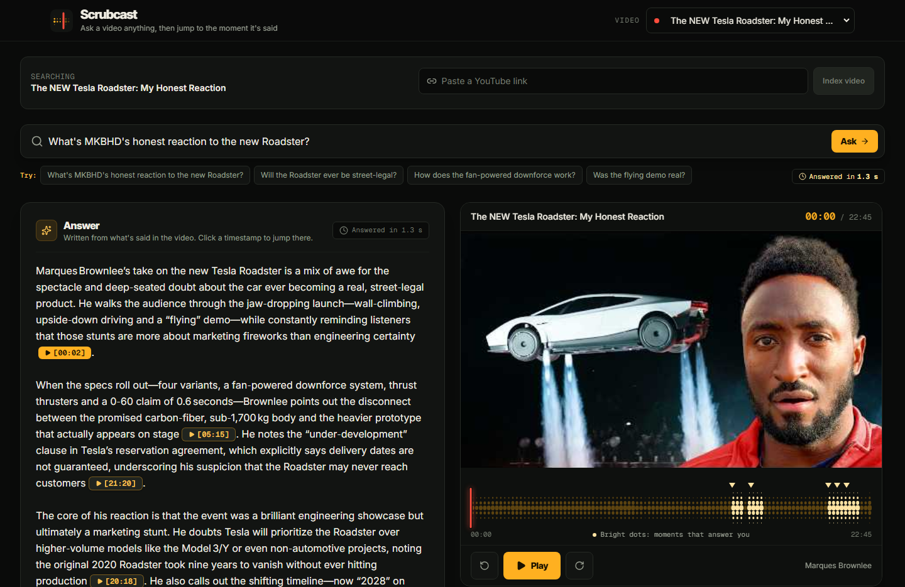
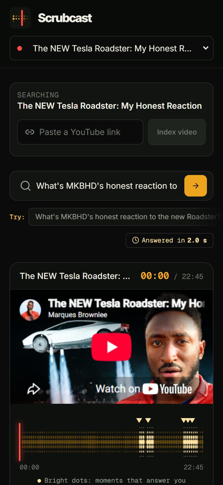

# Scrubcast

Ask a YouTube video a question. Get an answer with timestamps. Click a timestamp and the video jumps to that moment.

No more scrubbing through a 20-minute video to find one part. Just ask "Will the Roadster ever be street-legal?" and go straight to the answer.

## Screenshots

| Desktop | Mobile |
|---|---|
|  |  |

## What it can do

- Answer questions about any YouTube video that has captions and is up to 60 minutes long.
- Come with 7 ready-to-try videos (MKBHD, TED talks, Steve Jobs, 3Blue1Brown and more).
- Keep videos you paste private. Only you see them, and they're never saved to disk.

What it can't do yet:

- Videos without captions
- Podcast feeds or audio files
- Searching several videos at once

> **Note:** On the hosted site, pasting your own link usually fails because YouTube blocks most cloud servers. Run it on your own computer to use any video.

## How it works

1. **Read the video.** Scrubcast grabs the captions and cuts them into short pieces (30–45 seconds each).
2. **Find the right parts.** When you ask a question, it finds the 5 pieces that best match it.
3. **Write the answer.** An AI model (on [Groq](https://console.groq.com)) writes an answer using only those pieces, with timestamps like `[12:34]`.
4. **Jump.** Each timestamp is a button. Click it and the video plays from there.

In the background, Scrubcast also writes a summary of the whole video (overview, key points, chapters). This helps with big-picture questions like "What's the main point?" It takes about a minute for a 20-minute video.

## Run it on your computer

You need [Node.js](https://nodejs.org) 22 or newer.

```bash
git clone https://github.com/denzeltl/scrubcast.git
```

```bash
cd scrubcast
```

```bash
npm install
```

For written answers, get a free key at [console.groq.com](https://console.groq.com), then copy the example settings file:

```bash
cp .env.local.example .env.local
```

Put your key in `.env.local`:

```env
GROQ_API_KEY=gsk_your_key_here
```

Start the app:

```bash
npm run dev
```

Open [http://localhost:3000](http://localhost:3000). The first question takes a few seconds while it downloads a small model (about 30 MB).

No key? It still works. You'll see the best-matching quotes from the video instead of a written answer.

## Settings

All optional except the key.

| Setting | What it does |
|---|---|
| `GROQ_API_KEY` | Writes answers and summaries. |
| `GROQ_API_KEY_BACKUP` | A second key, used if the first one stops working or hits its limit. |
| `SITE_URL` | Your public web address, for link previews. |

Each visitor can add 5 videos per hour and ask 30 questions per 10 minutes. You can change these and other limits with environment variables (see `src/lib/rateLimit.ts` and `src/lib/ingest.ts`).

## Putting it online

Use the included `Dockerfile` on any host that runs a normal, always-on server (Railway, Render, Fly.io, a VPS). Give it about 1 GB of memory and set `GROQ_API_KEY`.

Don't use Vercel or Netlify. Scrubcast keeps videos in memory and runs summaries in the background, and those hosts shut things down after each request.

After deploying, paste a YouTube link to check it works. If it fails but works on your computer, YouTube is blocking your host. The 7 built-in videos keep working either way.

## Changing the built-in videos

1. Run the app with `SCRUBCAST_SAVE_LIBRARY=1` so pasted videos get saved.
2. Paste the new links and wait for each "About this video" card to fill in.
3. Edit the `FEATURED` list in [`scripts/build-index.ts`](./scripts/build-index.ts).
4. Run `npm run index`.

## Checks

```bash
npm run lint && npx tsc --noEmit && npm test && npm run build
```

GitHub Actions runs these on every push.

## Built with

Next.js 16, React 19, TypeScript, Tailwind CSS v4, Groq, and a small local embedding model (`bge-small-en-v1.5`) for matching questions to passages. The design rules live in [`DESIGN.md`](./DESIGN.md).
